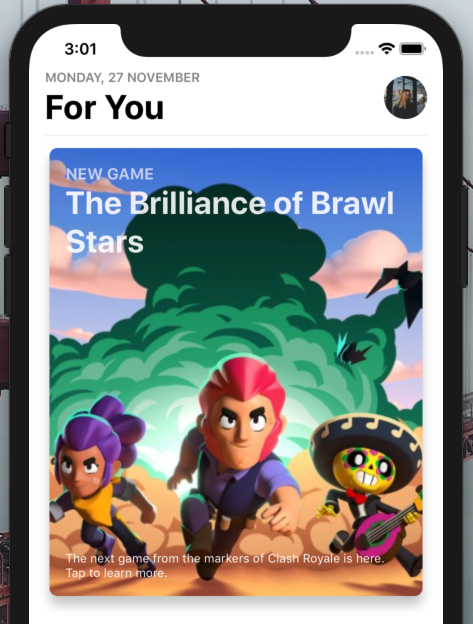
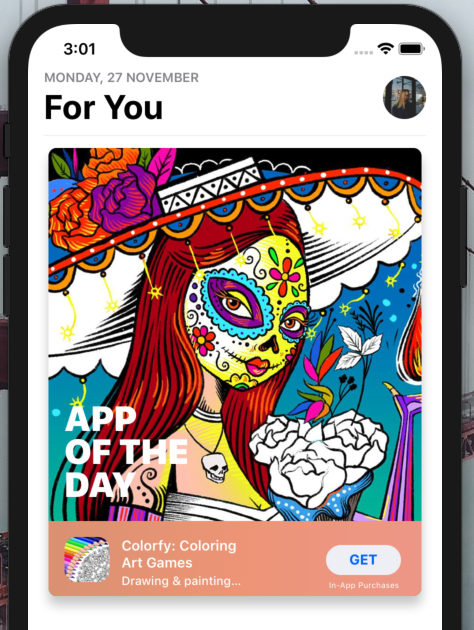

[](https://github.com/kuraydev/react-native-apple-card-views)
[](https://www.npmjs.com/package/react-native-apple-card-views)
[](https://www.npmjs.com/package/react-native-apple-card-views)

[](https://opensource.org/licenses/MIT)
[](https://github.com/prettier/prettier)

> Fully customizable, pixel-faithful clones of Apple's App Store card views for React Native — written in TypeScript, ships with types, and works with both the New and the Old Architecture.

<p align="center">
  
  
</p>

<p align="center">
  
</p>

## Features

- 🍏 Two presentational components: `AppleCard` (game hero card) and `AppOfTheDayCard`
- 🏝️ A single peer dependency (`@freakycoder/react-native-bounceable`) for the press bounce
- 🎪 Expo compatible — pure JS/TS, no native modules to link
- 🧩 New Architecture (Fabric) ready — only renders core RN primitives
- 📐 Responsive: the cards react to rotation / resize via `useWindowDimensions`
- ♿ Accessible: pressable areas expose `accessibilityRole="button"` + labels
- 🟦 First-class TypeScript types shipped in the package

## Installation

```bash
npm install react-native-apple-card-views @freakycoder/react-native-bounceable
# or
yarn add react-native-apple-card-views @freakycoder/react-native-bounceable
```

### Peer dependencies

This library declares the following peer dependencies — install them in your app
(`react` / `react-native` are already present in every RN project):

| Peer dependency | Supported range |
| --- | --- |
| `react` | `>=17.0.0` |
| `react-native` | `>=0.64.0` |
| `@freakycoder/react-native-bounceable` | `>=1.0.0` |

> No native linking / pod install step is required — the package is pure JavaScript/TypeScript.

## Compatibility

| Topic | Status |
| --- | --- |
| New Architecture (Fabric / TurboModules) | ✅ Compatible — renders only `View` / `Text` / `Image` / `ImageBackground`, no native module |
| Old Architecture (Paper) | ✅ Compatible |
| Expo (managed + bare) | ✅ Compatible — no custom native code |
| TypeScript | ✅ Types bundled (`build/dist/index.d.ts`) |

## Usage

```tsx
import {AppleCard, AppOfTheDayCard} from 'react-native-apple-card-views';
```

### `AppleCard`

```tsx
<AppleCard
  source={require('./assets/hero_bg_brawlstars.jpg')}
  smallTitle="NEW GAME"
  largeTitle="The Brilliance of Brawl Stars"
  footnote="The next game from the makers of Clash Royale is here. Tap to learn more."
  onPress={() => {}}
/>
```

### `AppOfTheDayCard`

```tsx
<AppOfTheDayCard
  title="Colorfy: Coloring Art Games"
  subtitle="Drawing & painting for everyone"
  largeTitle={'APP\nOF THE\nDAY'}
  buttonText="GET"
  buttonSubtitle="In-App Purchases"
  iconSource={require('./assets/Colorfy.jpg')}
  backgroundSource={require('./assets/ColorfyBG.jpg')}
  onPress={() => {}}
  onButtonPress={() => {}}
/>
```

### TypeScript

The prop interfaces are exported for convenience:

```tsx
import type {
  IAppleCardProps,
  IAppOfTheDayCardProps,
} from 'react-native-apple-card-views';
```

## Props

> ⚠️ There are **no default prop values** — the props listed as _required_ below
> must be supplied. (Previous READMEs documented defaults that did not exist.)

### `AppleCard`

| Prop | Type | Required | Description |
| --- | --- | :---: | --- |
| `source` | `ImageSourcePropType` | ✅ | Background image for the card |
| `smallTitle` | `string` | ✅ | Small eyebrow title above the large title |
| `largeTitle` | `string` | ✅ | Main large title |
| `footnote` | `string` | ✅ | Footnote text at the bottom of the card |
| `onPress` | `() => void` | ✅ | Called when the card is pressed |
| `style` | `StyleProp<ViewStyle>` | — | Style applied to the pressable wrapper |
| `shadowStyle` | `StyleProp<ViewStyle>` | — | Style for the outer shadow container |
| `backgroundStyle` | `StyleProp<ViewStyle>` | — | Style for the background image |
| `smallTitleTextStyle` | `StyleProp<TextStyle>` | — | Style for the small title text |
| `largeTitleTextStyle` | `StyleProp<TextStyle>` | — | Style for the large title text |
| `footnoteTextStyle` | `StyleProp<TextStyle>` | — | Style for the footnote text |
| `accessibilityLabel` | `string` | — | Overrides the default a11y label (`largeTitle`) |

> **Note:** the footnote prop is named **`footnote`** (older docs incorrectly called it `footnoteText`).

### `AppOfTheDayCard`

| Prop | Type | Required | Description |
| --- | --- | :---: | --- |
| `title` | `string` | ✅ | App title text |
| `subtitle` | `string` | ✅ | App subtitle text |
| `largeTitle` | `string` | ✅ | Main large title (use `\n` for line breaks) |
| `buttonText` | `string` | ✅ | Text inside the GET button |
| `buttonSubtitle` | `string` | ✅ | Subtitle under the button (e.g. "In-App Purchases") |
| `iconSource` | `ImageSourcePropType` | ✅ | App icon image |
| `backgroundSource` | `ImageSourcePropType` | ✅ | Background image for the card |
| `onPress` | `() => void` | ✅ | Called when the card is pressed |
| `onButtonPress` | `() => void` | ✅ | Called when the GET button is pressed |
| `style` | `StyleProp<ViewStyle>` | — | Style applied to the card container |
| `shadowStyle` | `StyleProp<ViewStyle>` | — | Style for the outer shadow container |
| `iconStyle` | `StyleProp<ImageStyle>` | — | Style for the app icon |
| `titleTextStyle` | `StyleProp<TextStyle>` | — | Style for the title text |
| `subtitleTextStyle` | `StyleProp<TextStyle>` | — | Style for the subtitle text |
| `largeTitleTextStyle` | `StyleProp<TextStyle>` | — | Style for the large title text |
| `buttonSubtitleTextStyle` | `StyleProp<TextStyle>` | — | Style for the button subtitle text |
| `gradientColors` | `string[]` | — | **Reserved / no-op.** Accepted for forward compatibility; does not currently render a gradient |
| `accessibilityLabel` | `string` | — | Overrides the default a11y label (`title`) |

## Running the example apps

Two example apps live in this repo:

- [`example/`](./example) — bare React Native
- [`example-expo/`](./example-expo) — Expo

```bash
cd example      # or example-expo
yarn install
yarn ios        # or: yarn android / yarn start
```

## Contributing

Contributions are welcome! Please read [CONTRIBUTING.md](./CONTRIBUTING.md) and the
[Code of Conduct](./CODE_OF_CONDUCT.md) before opening a PR. Commit messages follow
[Conventional Commits](https://www.conventionalcommits.org/).

## Changelog

See [CHANGELOG.md](./CHANGELOG.md) for a history of notable changes.

## Author

Kuray (FreakyCoder) — kurayogun@gmail.com
GitHub: [@kuraydev](https://github.com/kuraydev)

## License

React Native Apple Card Views is available under the MIT license. See the
[LICENSE](./LICENSE) file for more info.
